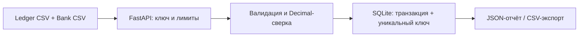

# Payment Reconciliation API

[](https://github.com/Sultanbro/payment-reconciliation/actions/workflows/checks.yml)

**Python · FastAPI · SQLite · Decimal · pytest · Docker**

Сервис сверки платежей: сравнивает выгрузку внутренней системы с банковским CSV и показывает, какие операции совпали, потерялись, продублировались или отличаются по сумме/валюте. Проект для портфолио backend-разработчика; все демонстрационные данные вымышлены.

Например, в учётной системе `PAY-002` имеет сумму `49.90 USD`, а в банке — `49.00 USD`: результат содержит `amount_mismatch`. Повторная загрузка с тем же ключом не создаёт второй отчёт.

## Быстрый запуск

Нужны Docker Compose и Python 3 для генерации конфигурации и демо.

```sh
git clone https://github.com/Sultanbro/payment-reconciliation.git
cd payment-reconciliation
python3 scripts/setup.py
docker compose up --build -d --wait
python3 scripts/demo.py
```

Интерактивная документация: **http://localhost:8000/docs**. Нажмите Authorize и укажите `API_KEY` из локального `.env`. Ключ генерируется случайно; `.env` не попадает в Git.

Демо загружает [ledger.csv](examples/ledger.csv) и [bank.csv](examples/bank.csv), проверяет шесть типов результата и повтор запроса. Ожидаемая сводка:

```json
{"matched":2,"missing_in_bank":1,"missing_in_ledger":1,"amount_mismatch":1,"currency_mismatch":1,"duplicate":1}
```

Остановить: `docker compose down`. Отчёты остаются в volume `data`. Команда `docker compose down -v` удаляет локальные данные.

## Контракт API

Все `/v1/*` требуют заголовок `X-API-Key`. `/health` открыт и проверяет доступность SQLite.

| Метод | Путь | Результат |
| --- | --- | --- |
| POST | `/v1/reconciliations` | Создать отчёт; обязателен `Idempotency-Key` |
| GET | `/v1/reconciliations/{id}` | Получить сохранённый отчёт |
| GET | `/v1/reconciliations/{id}/export` | Скачать CSV для разбора расхождений |
| GET | `/health` | Проверка сервиса |

Тело POST — JSON с двумя строками CSV:

```json
{
  "ledger_csv":"transaction_id,amount,currency\nPAY-1,100.00,USD\n",
  "bank_csv":"transaction_id,amount,currency\nPAY-1,100,USD\n"
}
```

Новый отчёт возвращает `201` и заголовок `Location`. Точный повтор с тем же ключом и входными строками — `200` с исходным ID. Изменённое содержимое с уже использованным ключом — `409`. Идемпотентность сохраняется после перезапуска. Даже различие пробелов считается изменением входных данных.

Ошибки: `401` — неверный ключ; `404` — отчёт не найден; `413` — тело больше 512 KB; `422` — неверная структура/CSV. До 5000 строк и 200000 символов на каждый CSV.

## Правила сверки

- Столбцы строго `transaction_id,amount,currency`; поддерживается UTF-8 BOM.
- ID: 1–80 латинских букв, цифр, `_` или `-`. Валюта: три заглавные латинские буквы; справочник ISO не проверяется.
- Сумма — десятичная запись, максимум 12 цифр до точки и 2 после. Отрицательные суммы представляют возвраты. Экспоненты и `NaN` отклоняются.
- Сравнение через `Decimal`: `0.10` равно `0.1`; конвертации валют нет.
- Дубликат ID в любом файле имеет приоритет: сервис возвращает все строки для ручной проверки и не выбирает одну произвольно.
- Для одиночных строк сначала проверяется наличие операции, затем валюта, затем сумма. Итоговая сводка считает уникальные ID, а не строки CSV.
- CSV-экспорт экранирует ID, которые могут интерпретироваться как формулы таблицы.

## Архитектура и решения



[`domain.py`](reconcile/domain.py) содержит чистую бизнес-логику. [`api.py`](reconcile/api.py) отвечает за HTTP, доступ и хранение. Отчёт и ключ запроса записываются одной транзакцией; уникальность и блокировка SQLite предотвращают создание нескольких отчётов конкурентными повторами.

Обработка синхронная и ограничена размером входа. Для небольших выгрузок это позволяет не поднимать отдельную очередь. Для больших файлов следующим шагом были бы фоновый worker, объектное хранилище, прогресс задачи и ограничения времени обработки.

Это однопользовательский внутренний API: один ключ открывает все отчёты. В проект не входят банковские интеграции, автоматическое исправление платежей, мультиарендность и обработка файлов произвольного размера. Для общего сервиса потребуются отдельные аккаунты, разграничение доступа, TLS, ограничения частоты запросов и правила хранения отчётов.

## Разработка и проверка

Нужен Python 3.12+.

```sh
python3 -m venv .venv
. .venv/bin/activate
pip install -r requirements-dev.txt
pytest -q
ruff check .
ruff format --check .
```

Запуск без Docker:

```sh
python3 scripts/setup.py
set -a; . ./.env; set +a
uvicorn reconcile.api:create_app --factory --host 127.0.0.1 --port 8000
```

`DATABASE_PATH` меняет путь к базе; по умолчанию `data/reports.db`.

Тесты проверяют шесть категорий сверки, точность сумм, некорректный CSV, лимиты, доступ, CSV-экспорт, сохранность после пересоздания приложения и 16 одновременных запросов с одним ключом. GitHub Actions запускает тесты, форматирование, аудит зависимостей и отдельное HTTP-демо в Docker.

## Источники подходов

- [FastAPI: тестирование](https://fastapi.tiangolo.com/tutorial/testing/) и [сборка Docker-образа](https://fastapi.tiangolo.com/deployment/docker/).
- [Python Decimal](https://docs.python.org/3/library/decimal.html) — десятичная арифметика.

MIT License.
